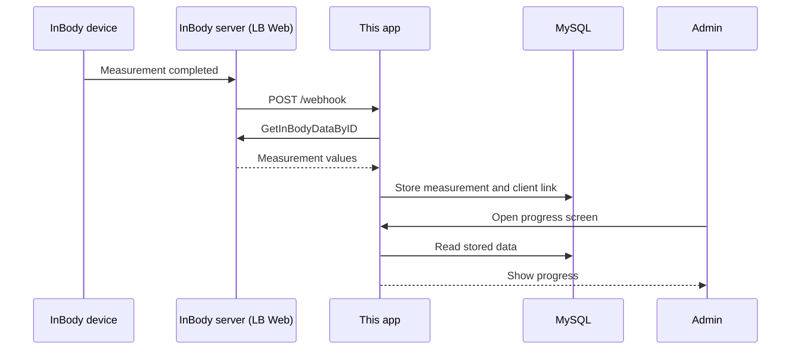

# InBody Progress Tracker

A minimal sample that links InBody measurements to your own clients and tracks their progress.

## What this sample shows

Other official samples such as webhook-server, data-viewer, and fitness-crm focus on receiving or displaying data. This small sample focuses on the practical pieces needed when you connect InBody to your own service.

- Link measurements to your own client list by phone number.
- Show progress since the first measurement.
- Stay within the daily API limit: one action makes at most one API call.
- Safely expose the app with ngrok by using Basic Auth and a webhook header.

## How it works



A webhook does not contain body-composition values. It only says that a measurement happened. The app then calls the InBody API once to get the values.

## Design principle: one action, at most one API call

| Action                                    | InBody API calls |
| ----------------------------------------- | ---------------: |
| Incoming webhook                          |        At most 1 |
| Opening pages                             |                0 |
| Add, edit, or delete a client             |                0 |
| Refetch a failed or temporary measurement |        At most 1 |

The normal daily InBody API limit is 500 calls. This app keeps 50 calls in reserve, so it stops at 450 by default. The reserve leaves room for calls made with the same key outside this app, for example in Postman.

## Prerequisites

- An LB Web account. InBody Developers uses your LB Web account for sign-in.
- An InBody Developers API key. Register the public IP address of the server running this app in the InBody Developers IP whitelist.
- Node.js 20 or later.
- MySQL 8.
- ngrok, when you run the app on your own computer and need to receive webhooks.

## Getting started

### 1. Clone and install

Run these commands in a terminal. Replace `<repository-url>` with the repository address you received.

```bash
git clone <repository-url>
cd inbody-progress-tracker
npm install
```

### 2. Create the database

`schema.sql` creates both the `inbody_progress_tracker` database and its tables.
Run this command in a terminal from the project folder, and enter your MySQL root password when asked:

```bash
mysql -u root -p -e "source schema.sql"
```

Check that the tables were created:

```bash
mysql -u root -p -e "SHOW TABLES FROM inbody_progress_tracker;"
```

You should see `api_usage`, `customers`, and `measurements`.

> **`mysql` is not recognized?** Add the MySQL `bin` folder to your `PATH`, or run the command with the full path.
> On Windows, the default location is `C:\Program Files\MySQL\MySQL Server 8.0\bin\mysql.exe`.

### 3. Create `.env`

Copy `.env.example` to `.env`. Fill in the values on the right side of each `=`. Do not commit `.env`; it contains passwords and API keys.

| Key                    | What to enter                                                                                                                                                       |
| ---------------------- | ------------------------------------------------------------------------------------------------------------------------------------------------------------------- |
| `PORT`                 | `4174`, unless you need a different local port.                                                                                                                     |
| `DB_HOST`              | Usually `localhost`.                                                                                                                                                |
| `DB_PORT`              | Usually `3306`.                                                                                                                                                     |
| `DB_USER`              | Your MySQL user, often `root` for local development.                                                                                                                |
| `DB_PASSWORD`          | Your MySQL password.                                                                                                                                                |
| `DB_NAME`              | `inbody_progress_tracker`.                                                                                                                                          |
| `INBODY_BASE_URL`      | The base URL supplied by InBody Developers. Add `/sandbox` to use its sandbox environment.                                                                          |
| `INBODY_ACCOUNT`       | Your LB Web account.                                                                                                                                                |
| `INBODY_API_KEY`       | Your InBody Developers API key.                                                                                                                                     |
| `INBODY_DAILY_LIMIT`   | Your daily API-call limit, normally `500`.                                                                                                                          |
| `INBODY_RESERVE`       | Calls to keep in reserve, normally `50`.                                                                                                                            |
| `WEBHOOK_HEADER_NAME`  | A header name you choose, such as `X-InBody-Secret`.                                                                                                                |
| `WEBHOOK_HEADER_VALUE` | A long random string you choose. Enter the same header name and value in InBody Developers webhook settings. This prevents unknown callers from calling `/webhook`. |
| `BASIC_AUTH_USER`      | The user name your browser asks for when you open the app.                                                                                                          |
| `BASIC_AUTH_PASSWORD`  | The password your browser asks for when you open the app. Optional: if empty, Basic Auth is off. **Set it before exposing the app with ngrok.**                     |

### 4. Start and sign in

```bash
npm start
```

Open [http://localhost:4174](http://localhost:4174). If `BASIC_AUTH_PASSWORD` is set, your browser asks for `BASIC_AUTH_USER` and `BASIC_AUTH_PASSWORD`. Enter the values from `.env`.

If `BASIC_AUTH_PASSWORD` is empty, the app opens without sign-in and shows a yellow warning banner. This is fine on your own computer, but set a password before you expose the app with ngrok.

## Try it without a device

You can see the full flow without an InBody device by using the InBody Developers sandbox.
The sandbox has one demo member, `sandbox_user`, with two measurements: `20240601120000` and `20240601130000`.

1. In `.env`, set `INBODY_BASE_URL` to the sandbox URL (your base URL + `/sandbox`) and `INBODY_API_KEY` to your test key (`test_...`). Restart the server.
2. In the app, add a client with the phone number `010-0000-0001`.
3. Send a sample webhook. Replace `<your value>` with your `WEBHOOK_HEADER_VALUE`.

**macOS / Linux**

```bash
curl -X POST http://localhost:4174/webhook \
  -H "Content-Type: application/json" \
  -H "X-InBody-Secret: <your value>" \
  -d '{"UserID":"sandbox_user","TelHP":"01000000001","TestDatetimes":"20240601120000","IsTempData":"false"}'
```

**Windows (PowerShell)**

```powershell
Invoke-RestMethod -Method Post -Uri http://localhost:4174/webhook `
  -ContentType "application/json" `
  -Headers @{ "X-InBody-Secret" = "<your value>" } `
  -Body '{"UserID":"sandbox_user","TelHP":"01000000001","TestDatetimes":"20240601120000","IsTempData":"false"}'
```

4. Send it again with `"TestDatetimes":"20240601130000"`. The client now has two measurements, so the app shows the changes and a chart.

Each webhook uses one API call. Sending the same webhook twice does not call the API again.
If you changed `WEBHOOK_HEADER_NAME`, use that name instead of `X-InBody-Secret`.
If nothing changes in the app, that measurement may already be stored from an earlier try. The app skips measurements it already has, so it does not call the API again. Delete the client and its measurements, or try the other measurement time.

## Receive webhooks with ngrok

`localhost` is only available on your computer. ngrok creates a temporary public address so the InBody server can send a webhook to your app.

> **Before you start:** set `BASIC_AUTH_PASSWORD` in `.env`. Without it, anyone with the ngrok address can open the app and its API.

1. Create an account at [ngrok](https://ngrok.com/) and install ngrok.
2. Copy your ngrok authtoken from the ngrok dashboard. In a terminal, run:

   ```bash
   ngrok config add-authtoken <your-authtoken>
   ```

3. Start this app with `npm start`. In a second terminal, run:

   ```bash
   ngrok http 4174
   ```

4. Copy the HTTPS address shown by ngrok, such as `https://example.ngrok-free.app`.
5. In InBody Developers webhook settings, enter `https://example.ngrok-free.app/webhook`. The `/webhook` path is required.
6. In the same webhook settings, enter the `WEBHOOK_HEADER_NAME` and `WEBHOOK_HEADER_VALUE` from `.env`.
7. Run the webhook test in InBody Developers.

The free ngrok address changes each time ngrok starts. Register the new address in InBody Developers when it changes. Basic Auth protects the screen and normal API paths at the public ngrok address. The webhook itself uses its separate custom header because the InBody server cannot enter browser credentials.

## Using the app

When you add a client, use the **same phone number** that is entered on the InBody device. Then measure the client using that phone number on the device.

| Event         | Linking rule                                                                                                                 |
| ------------- | ---------------------------------------------------------------------------------------------------------------------------- |
| New webhook   | An unlinked measurement is linked when its phone number matches a client.                                                    |
| Add client    | Existing unlinked measurements with the same phone number are linked.                                                        |
| Edit phone    | Existing linked measurements stay linked. Other unlinked measurements with the new phone number are linked.                  |
| Delete client | Measurements stay in MySQL. Their client link is cleared and they link again if you add a client with the same phone number. |

The client detail page compares the first successful measurement with the latest successful measurement. It does not label a change as good or bad.

## Project structure

```text
inbody-progress-tracker/
├── server.js             Express server, Basic Auth, and HTTP routes
├── db.js                 MySQL pool and all SQL queries
├── schema.sql            Database and table creation script
├── .env.example          Configuration template
├── inbody/
│   ├── client.js         The only file that calls the InBody API
│   ├── transform.js      Measurement and phone-number helpers
│   └── webhook.js        Webhook, linking, limit, and refetch flow
└── public/
    ├── index.html        Page structure, styles, and Chart.js CDN link
    └── app.js            Browser UI and hash routes
```

## API endpoints

| Method   | Path                            | Description                                                                           | InBody calls |
| -------- | ------------------------------- | ------------------------------------------------------------------------------------- | -----------: |
| `POST`   | `/webhook`                      | Receives an InBody measurement notification. Uses the webhook header, not Basic Auth. |    At most 1 |
| `GET`    | `/api/health`                   | Checks the MySQL connection.                                                          |            0 |
| `GET`    | `/api/status`                   | Returns daily usage and webhook status.                                               |            0 |
| `GET`    | `/api/customers`                | Lists clients and successful measurements.                                            |            0 |
| `GET`    | `/api/customers/:id`            | Returns one client and all linked measurements.                                       |            0 |
| `POST`   | `/api/customers`                | Adds a client and links matching unlinked measurements.                               |            0 |
| `PUT`    | `/api/customers/:id`            | Updates a client and links newly matching measurements.                               |            0 |
| `DELETE` | `/api/customers/:id`            | Deletes a client and clears measurement links.                                        |            0 |
| `POST`   | `/api/measurements/:id/refetch` | Retries an `error` or `skipped_temp` measurement.                                     |    At most 1 |

## Troubleshooting

### Webhooks are not arriving

Check that ngrok is running. Check that the registered URL includes `/webhook`; without it, the request returns `404`. Check that the header value matches exactly. A mismatch returns `401` and the server logs `[webhook] rejected: invalid header`.

### A measurement shows "authentication failed (401)"

Check `INBODY_ACCOUNT` and `INBODY_API_KEY` in `.env`. Restart the server after changing `.env`. Also check that the server's public IP is registered in the InBody Developers IP whitelist.

### A measurement shows "not found (404)"

Check that the measurement exists in LB Web for that client and measurement time.

### A measurement shows "Daily limit reached"

Use **Refetch** on the next day. The app does not send a request after its allowed daily call count is reached.

### A measurement is not linked to a client

The phone number may not match, or the device measurement may have no phone number. Correct the client phone number and the app links matching unlinked measurements automatically.

### I changed `.env`

Restart the server after every `.env` change.

## Data stored

The app stores only five measurement values: skeletal muscle mass, body fat mass, percent body fat, visceral fat level, and basal metabolic rate. It does not store the full InBody API response, including names, dates of birth, or other personal data returned by the API.

The daily usage counter can count only calls made by this app. It cannot see calls made with the same API key by other tools or services.
